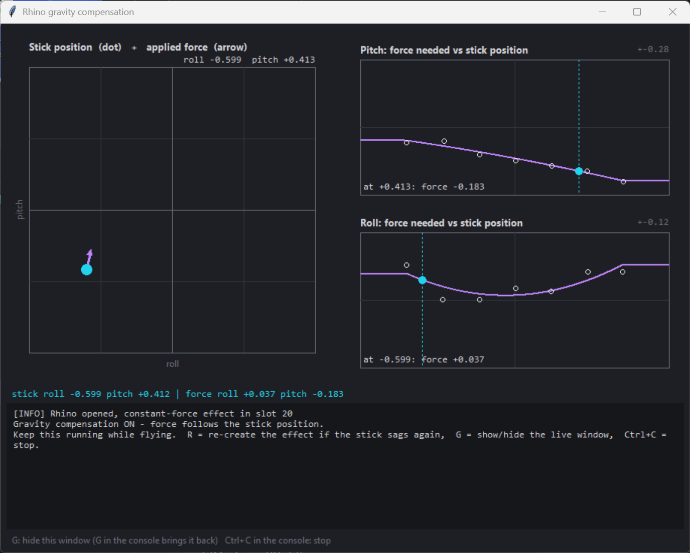

# Rhino gravity compensation

A free Python script for the **VPforce Rhino** force-feedback stick. If your stick sags or falls to one side when you let go, because of an angled mount, an extension, an offset elbow or a heavy grip, it cancels that weight so the stick stays wherever you leave it, in any flight sim.

> **Unofficial community tool**, not made or supported by VPforce. It sends force commands straight to your stick. Keep the Rhino's emergency stop within reach, especially the first time you calibrate. Use at your own risk.

> **Using VPforce TelemFFB?** Read the [TelemFFB warning](#warning-vpforce-telemffb) first.

## What it does

The script measures how hard gravity pulls the stick at several positions, then applies exactly the opposite force for wherever the stick is, updated about 200 times a second.

This matters because the pull changes with position. With the weight hanging behind the pivot, the stick is pulled back hard when it's aft. As it moves forward, the weight swings over the pivot and the pull fades or even reverses. A single constant force, like the configurator's static force effect, can only be right at one position: it helps when the stick is aft, but pushes it forward when the stick is forward. The configurator's balance spring has the opposite limitation: it adds force in proportion to distance from centre, so it can't supply a constant part.

The force is sent directly to the Rhino over USB, the same way VPforce's TelemFFB adds its effects. It adds to whatever the sim and the configurator are doing.

## Requirements

- A VPforce Rhino. Tested on firmware 1.0.18; DIY bases on VPforce kits may work but are untested.
- Windows, with Python 3.13 and the `hidapi` library.

## Install

1. Install Python 3.13 from [python.org](https://www.python.org/downloads/). Newer versions may not have the library available yet.
2. Open a command prompt and install the library:

   ```
   py -3.13 -m pip install hidapi
   ```

3. Download `rhino_gravity_comp.py` (green **Code** button → **Download ZIP**, or the file itself) and put it in a folder of its own, for example `C:\RhinoComp`. It saves its calibration next to itself, in `rhino_gravity_comp.json`.

All commands below start with `py -3.13` and are run from that folder. If 3.13 is your only Python, plain `py` works too.

## Calibrate once

Calibration measures the pull across the stick's travel by itself, hands off, in about two minutes. It measures the stick, not the sim, so one calibration covers every sim.

1. Close every flight sim, and TelemFFB.
2. In the VPforce configurator, make sure the constant-force slider isn't at 0. If a spring is switched on in the Effects tab, switch it off for the calibration.
3. Master gain: if you never touch it, leave it as it is. If the script drives it from a pot (see [Master gain from the pot](#master-gain-from-the-pot-optional)), the script calibrates at 50% by itself and puts the gain back afterwards.
4. Run:

   ```
   py -3.13 rhino_gravity_comp.py --calibrate
   ```

5. Let go of the stick before the 5-second countdown ends, and don't touch it until it says `Saved`.

What happens: the script first clears all effects from the stick. A temporary spring then walks the stick to 7 positions from 70% aft to 70% forward, first in pitch, then in roll. At each one, the script finds the force that holds the stick there and prints it, for example `[pitch] at -0.467 gravity needs -0.411`. It fits a smooth curve through those values and saves it.

- Calibrate pitch only with `--pitch-only`. Measure further out with `--range 0.8`, or at more positions with `--points 9`.
- A point marked "not settled" is skipped; the curve is fitted through the rest.
- To recalibrate, run `--calibrate` again. It replaces the old curve.

**Trim (optional):** `py -3.13 rhino_gravity_comp.py --tune` shifts the whole curve up or down. Use `w`/`s` for pitch and `a`/`d` for roll (capitals take bigger steps), Enter to save and `q` to quit without saving. Use it if the stick creeps the same way at every position.

## The live window



The live window shows what the script is doing: the stick position and the force being applied, the force curves with the measured points, and every message the script prints, in a log panel with warnings in orange. The console keeps printing too. It uses tkinter, which comes with Python on Windows.

- **Calibration** opens the window automatically. It stays open when calibration finishes so you can check the curves; close it to exit. Add `--no-gui` to calibrate without it.
- **Flying and trim** start with the window hidden. Add `--gui` to start with it showing.
- **Press G** in the console to show or hide the window at any time, or press G in the window to hide it. Closing the window with X only hides it; the script keeps running.
- **Keys work in the window too:** R while flying, and the trim keys.

## Master gain from the pot (optional)

If you use a pot on the stick as master gain, the script can take that job over, and then keep the anti-sag force correct at every gain setting. Without this, turning the gain down also weakens the script's force, so the stick sags again.

1. In the VPforce configurator, set **Pot#1 Function** to an axis, for example **Rx**, instead of Master Gain.
2. Let the script find the pot (it's saved). Leave the stick alone and turn the pot slowly from end to end, twice, within 15 seconds:

   ```
   py -3.13 rhino_gravity_comp.py --find-pot
   ```

   It reports where it found the pot and its range, for example `Found the pot: byte 11, 16-bit, range 0-4080`. Where the pot shows up in the stick's data can differ between firmware versions, which is why it's located rather than assumed.
3. Calibrate once with this version, then fly as usual. With a pot set up, calibration runs at 50% master gain by itself and puts the gain back afterwards, so the pot's position doesn't matter.

While the script runs, turning the pot moves the configurator's Master Gain slider, and the script scales its own force to match. The status line shows the current gain and the pot's raw value.

- **Safety:** the script doesn't touch Master Gain until it has seen the pot move. Until then the gain stays as it is, so a wrong or dead pot reading can't zero it.
- **Beeps:** turning the pot gives a short pip at every 10% step, higher for more gain. The Rhino's own buzzer can't be driven from outside, so the pip is a tiny, fast vibration of the motors. It needs the configurator's Periodic Effects slider above 0. `--beep off` switches the pips off (saved).

- `--gain-range 20 100` limits the pot's range, here from 20% to 100% master gain.
- `--gain-pot off` switches it off again.
- The pot only works while the script runs. When it stops, the master gain stays where it was. Keep the emergency stop within reach, since the pot is no longer a direct "turn it all down" knob.
- At low gain the script needs more force of its own. If it hits its limit, it warns you and the stick sags a little. Turn the gain up, or allow more with `--max`.
- The configurator's slider may not move along on screen while the configurator is open.

## Flying with it

Start the script before or after your sim, and keep it running the whole time you fly:

```
py -3.13 rhino_gravity_comp.py
```

- **It recovers by itself.** Sims with force feedback (DCS, IL-2, X-Plane, Condor and others) wipe all effects on the stick when they take it over, for example at the start of a flight or when you alt-tab. The script notices within a second and restores its force. A short sag in that second is normal.
- **The sim's forces add on top.** Its trim, centering springs and shake effects work as usual.
- **G** shows or hides the live window.
- **R** re-creates the force effect, if the stick ever stays saggy.
- **Ctrl+C** in the console stops the script and removes its force from the stick immediately.

Tip: make a shortcut or a `.bat` file containing `py -3.13 C:\RhinoComp\rhino_gravity_comp.py`, so it's one click before each session.

## Warning: VPforce TelemFFB

**Running this script and TelemFFB at the same time is untested.** It may work, but two things can go wrong:

- **Slot clashes.** The Rhino stores effects in numbered slots. To stay out of the sim's way, the script keeps its effects in slots 20–25 and clears those slots each time it starts. TelemFFB can create many effects at once and may use the same slots. The script could then remove some of TelemFFB's effects at startup, or the two programs could overwrite each other's forces.
- **Same label.** The script marks its effects as coming from TelemFFB, as VPforce's own software does. How the stick behaves when two programs use that label at once is unknown.

If you try it anyway: calibrate with TelemFFB closed, start TelemFFB first and the script second, and keep the emergency stop within reach. If TelemFFB effects go missing or forces act strangely, stop the script.

## Troubleshooting

Check the result with no centering force: let go of the stick aft, at centre and forward. It should stay put, or creep only slowly, at all three.

| Problem | Fix |
| --- | --- |
| `No module named 'hid'` | `py` is running a different Python than the one with the library. The error names which one. Use `py -3.13`. |
| `Could not create an effect on the Rhino` | Check that the stick is plugged in and the emergency stop is released. Close the VPforce configurator if it's open, then try again. If it still fails, unplug and replug the stick. |
| Calibration: "barely reacts to force" | FFB is off, or the constant-force slider in the configurator is at 0. |
| Calibration: "the calibration spring can't move the stick" | Something else is holding the stick: a sim, TelemFFB, or a spring in the configurator's Effects tab. Close or disable it and try again. |
| A push remains after the script is closed | With all sims closed, run `py -3.13 rhino_gravity_comp.py --clear`, or unplug and replug the stick. The script also removes its own leftovers each time it starts. |
| Stick creeps the same way at every position | Trim with `--tune`. |
| Stick holds in the middle but drifts near the ends | Recalibrate with `--range 0.8` so the curve covers more of the travel. |
| Force feels wrong after changing master gain | Calibrate once with this version: it records the gain, and from then on the force follows gain changes. If the pot is your master gain, use [the pot option](#master-gain-from-the-pot-optional). |
| Stick sags again mid-flight | Press `R`. |

## All options

```
py -3.13 rhino_gravity_comp.py --help
```

| Option | What it does |
| --- | --- |
| `--calibrate` | Measure the gravity pull across the travel and save the curve |
| `--tune` | Trim the saved curve by hand |
| `--clear` | Remove every force effect from the stick (close all sims first) |
| `--gui` / `--no-gui` | Start with the live window showing / hidden |
| `--pitch-only` | Calibrate pitch only |
| `--points N` | Positions per axis during calibration (default 7) |
| `--range R` | How far out to measure, as a fraction of full travel (default 0.7) |
| `--max F` | Force limit at the stick, as a fraction of full force at 100% gain (default 0.6) |
| `--find-pot` | Locate the pot in the stick's data and let it drive Master Gain (saved) |
| `--gain-pot off` | Stop the pot driving Master Gain (saved) |
| `--gain-range LOW HIGH` | Master gain at the pot's two ends, in percent (saved) |
| `--beep on` / `--beep off` | Pips through the motors when the pot changes master gain (saved) |

## License

GPL-3.0, see [LICENSE](LICENSE). The Rhino HID protocol details come from [VPforce TelemFFB](https://github.com/walmis/VPforce-TelemFFB) (GPL-3.0, © 2023 Valmantas Palikša).
